<div align="center">
  

  <h1>Deck Lotus</h1>

  <p><strong>A self-hosted home for your Magic: The Gathering decks, cubes and collection.</strong><br>
  Build it, test it, see what you already own, and buy the rest for the least money.</p>

  <p>
    <a href="https://github.com/madeofpendletonwool/deck-lotus/actions/workflows/docker-publish.yml"></a>
    <a href="https://github.com/madeofpendletonwool/deck-lotus/pkgs/container/deck-lotus"></a>
    
    
  </p>

  <p>
    <a href="#-quick-start"><strong>Quick start</strong></a> ·
    <a href="#-a-quick-tour">Tour</a> ·
    <a href="#-everything-it-does">All features</a> ·
    <a href="#-configuration">Configuration</a> ·
    <a href="#-api">API</a>
  </p>

  <br>

  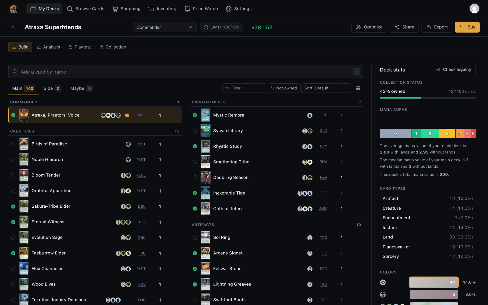
</div>

<br>

## Why Deck Lotus?

Most deck builders stop at the list. Deck Lotus covers the rest: will the mana work, which cards are already in your binder, what the missing ones cost, and which seller is cheapest. You run it on your own server, and your collection and your playgroup's decks stay there.

<table>
  <tr>
    <td width="33%" valign="top">
      <h3>🛠️ Build</h3>
      Decks for 20+ formats with real legality checks, and cubes laid out the way CubeCobra users expect. Pick every printing, drag between boards, import from anywhere.
    </td>
    <td width="33%" valign="top">
      <h3>🧪 Test</h3>
      Frank Karsten-style mana base math, draw odds for any condition you can describe, and a goldfish playtester with mulligans, zones, tokens and undo. Cubes get draft bots.
    </td>
    <td width="33%" valign="top">
      <h3>💰 Own &amp; buy</h3>
      Track your collection, see which deck holds each copy, get a shopping list across all your decks, and let the Mana Pool optimizer find the cheapest cart. Price alerts go to your phone.
    </td>
  </tr>
</table>

<br>

## ✨ A quick tour

### Your decks and cubes, at a glance

Every deck and cube shows its art, format and current value.

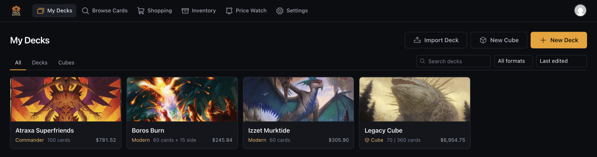

### Know the mana works before you sleeve it

The **Analysis** tab works out, for every colored cost in the deck, the chance you'll have the right sources on the turn you want to cast it. It follows Frank Karsten's method: London mulligans, on the play or the draw, against a 90% target. Fetches, double-faced lands and Command Tower count for the colors they can really produce in your deck.

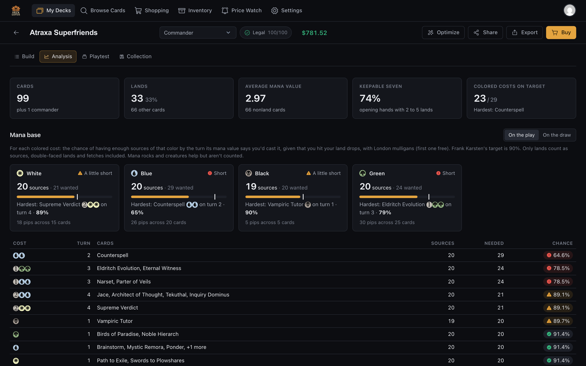

### Goldfish it in the browser

A playtester with London mulligans, untap and draw, tapping, counters, tokens, a graveyard, exile, a command zone with commander tax, scry, surveil, library search, a game log and undo. It also has keyboard shortcuts.

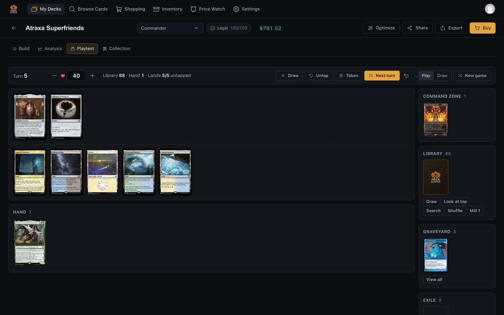

### Build from what you own

The **Collection** view checks a deck against your binder. You see what you own, which copies another deck is using, and what the rest costs. One click puts free copies into the deck, or copies the missing cards as a list for TCGplayer or Mana Pool.

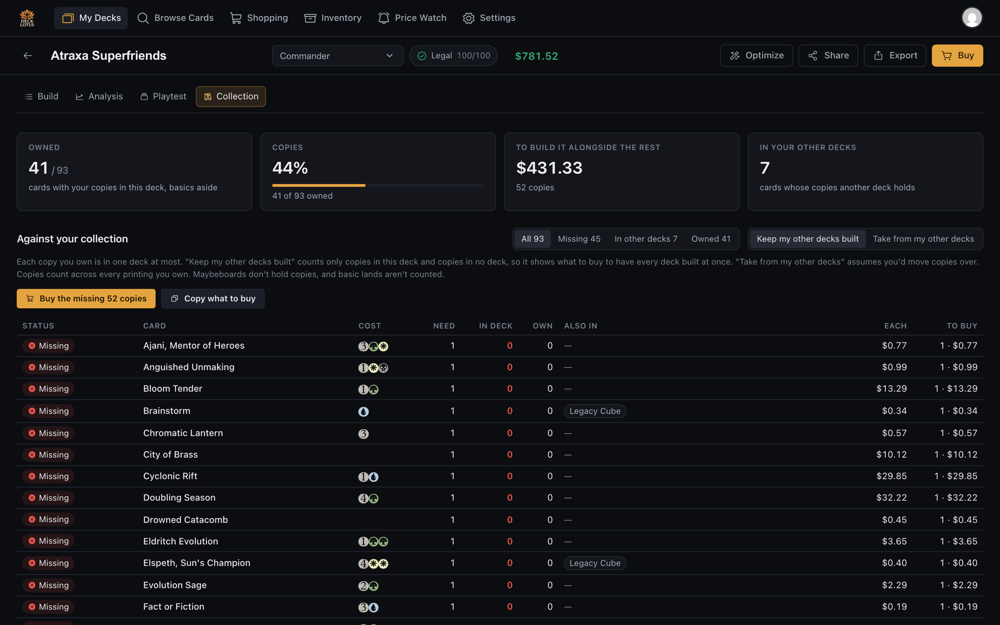

### Cubes

A cube is a deck with the Cube format, so pricing, printings, ownership and sharing all work on it. Lay it out in CubeCobra's color columns or as a visual spoiler, tag and recategorize cards in bulk, then check color balance and fixing for every color pair.

<table>
  <tr>
    <td width="50%">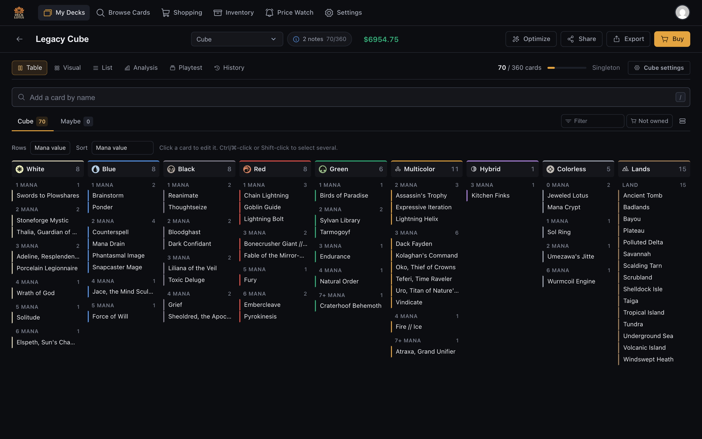</td>
    <td width="50%">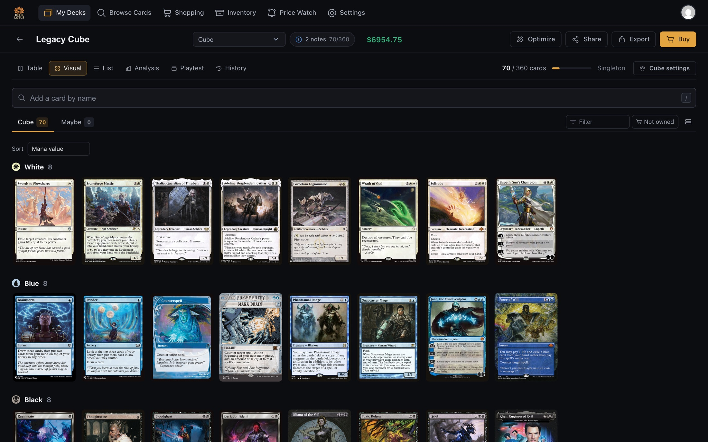</td>
  </tr>
  <tr>
    <td colspan="2">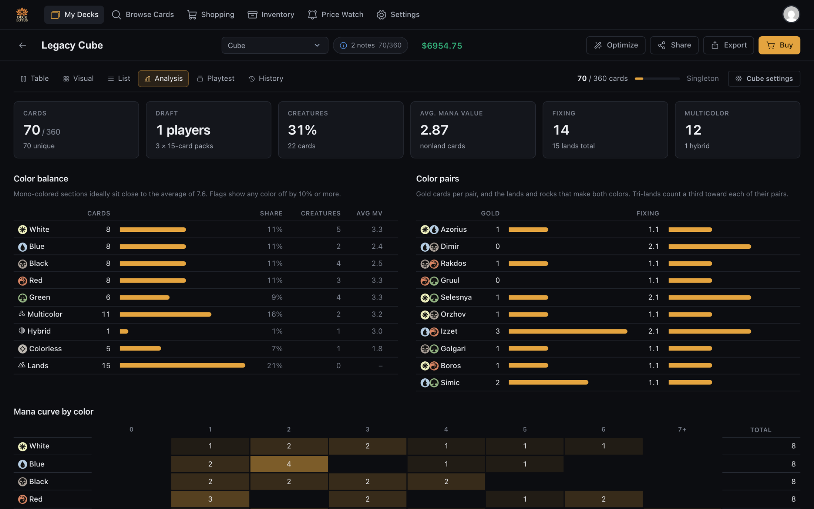</td>
  </tr>
</table>

You can also open sample packs or a sealed pool, or draft against bots that pick by power and settle into colors. Any pool you end up with can be saved as a Limited deck.

### Every card, every printing

Browse the full card pool with color, type, set and rarity filters. The card detail view has prices for each printing, buy links, legality, rulings, languages, and which of your decks use the card.

<table>
  <tr>
    <td width="50%">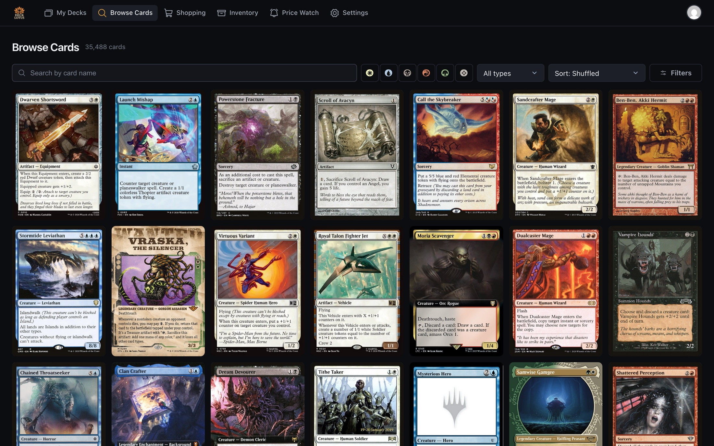</td>
    <td width="50%">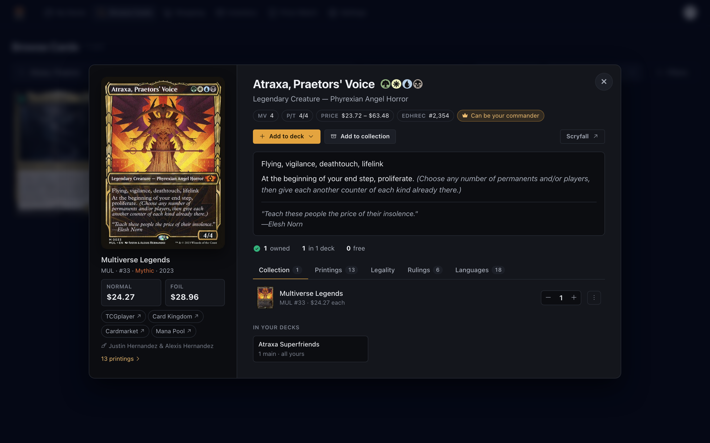</td>
  </tr>
</table>

### Your collection, valued

The inventory tracks quantity per printing and finish and shows what the collection is worth. You can see which copies are in decks, which are free, and which cards are **contested**, meaning more than one deck wants your only copy. Search it with the same syntax as everywhere else: `t:creature c:g usd>=5 is:foil`.

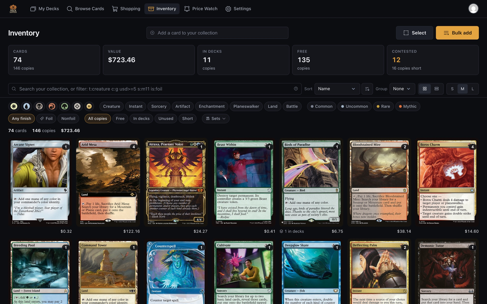

### Shop smarter

The shopping list combines every missing card from the decks you pick, grouped by set, color, type, rarity or price. Check cards off as you find them at your LGS, or send the whole list to the **Mana Pool cart optimizer**. It finds the cheapest mix of sellers with four strategies: lowest price, fewest packages, balanced, or gathered shipping only.

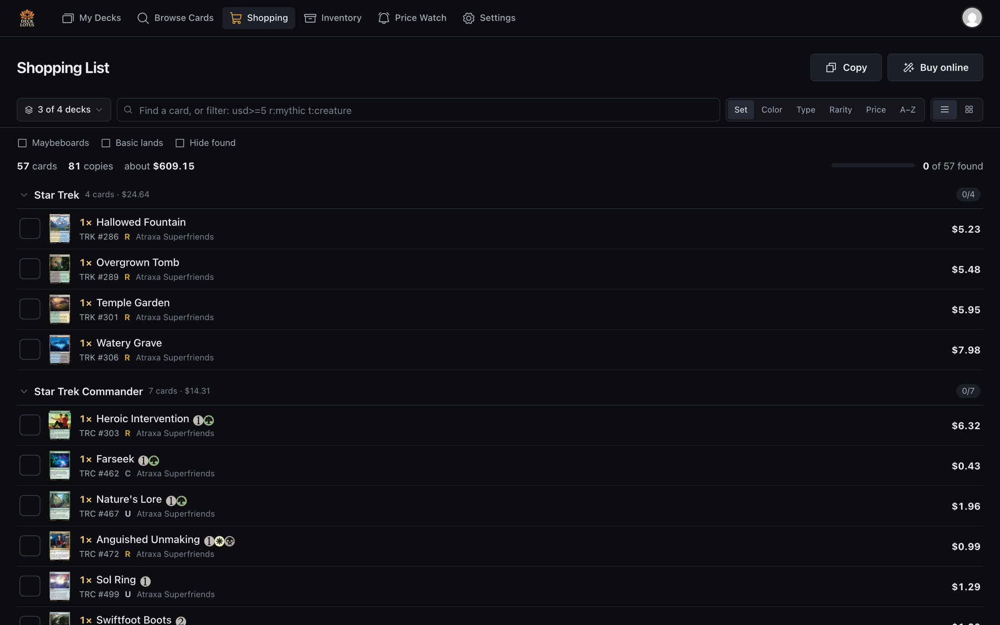

### And the rest

- 🔔 **Price watches**: set a target price and condition. Deck Lotus checks on a schedule and pushes an alert to your phone through [ntfy](https://ntfy.sh), with a price history chart for each watch.
- 🔁 **Import and export**: Moxfield, MTG Arena, MTGO, plain text, CSV and CubeCobra.
- 🔗 **Share links**: a read-only deck page anyone can open. Signed-in viewers see how much of it they already own and can save a copy.
- 🎨 **Themes**: nine per-user color themes.
- 👥 **Multi-user**: everyone gets their own decks, inventory and watches, with JWT auth, API keys, and admin tools for backup and restore.

<br>

## 🚀 Quick start

One container, SQLite, no external database. On first boot it downloads card data from MTGJSON, which takes about two minutes.

```bash
mkdir -p deck-lotus-data

cat > docker-compose.yml << 'EOF'
services:
  deck-lotus:
    image: ghcr.io/madeofpendletonwool/deck-lotus:latest
    ports:
      - "3000:3000"
    environment:
      - NODE_ENV=production
      - JWT_SECRET=replace-with-a-long-random-secret
      - ADMIN_USERNAME=admin
      - ADMIN_EMAIL=admin@example.com
      - ADMIN_PASSWORD=changeme123
      # Optional but recommended: enables price monitoring and the cart optimizer
      - MANAPOOL_USER_EMAIL=
      - MANAPOOL_API_TOKEN=
      # Optional: push notifications for price alerts
      - NTFY_TOPIC=
    volumes:
      - ./deck-lotus-data:/app/data
    restart: unless-stopped
EOF

docker compose up -d
```

Open **http://localhost:3000** and sign in. To generate a proper JWT secret:

```bash
node -e "console.log(require('crypto').randomBytes(64).toString('hex'))"
```

<details>
<summary><strong>Build from source instead</strong></summary>

```bash
git clone https://github.com/madeofpendletonwool/deck-lotus.git
cd deck-lotus

cp .env.example .env
# Edit .env and set JWT_SECRET at minimum

docker compose up -d --build
```

</details>

<br>

## 📋 Everything it does

<details>
<summary><strong>Full feature list</strong> (click to expand)</summary>

### Deck Building
- **Intuitive Deck Builder** — real-time search with autocomplete as you type
- **Multiple Boards** — mainboard, sideboard, and maybeboard support
- **Commander Support** — mark commanders, color identity displayed automatically
- **Multiple Printings** — choose specific card art, set, and foil version per card
- **Printing Optimizer** — automatically find the cheapest or most thematic set for your entire deck
- **Deck Statistics** — live mana curve, type distribution, color breakdown, and estimated value
- **Format Support** — Standard, Pioneer, Modern, Premodern, Legacy, Vintage, Pauper, Timeless, Historic, Alchemy, Penny Dreadful, Old School; Commander, Duel Commander, Pauper Commander, Brawl, Standard Brawl, Oathbreaker, Pre-EDH; Canadian Highlander, Gladiator; Two-Headed Giant; Limited
- **Real Legality Checks** — deck size, copy limits (basics and "any number of" cards exempt), restricted cards, sideboard size, commander eligibility per format, partners and backgrounds, color identity, Canadian Highlander points, and the Two-Headed Giant team limit. A chip in the deck header shows the result live, and one click lists every format the deck is legal in
- **Drag & Drop** — reorder cards between boards
- **Layout Views** — full card, compact, and ultra-compact views

### Deck Analysis and Playtesting
Every deck (and every shared deck link) has **Analysis** and **Playtest** views next to the list, at `/decks/:id/analysis` and `/decks/:id/playtest`.
- **Mana Base Check** — for each colored cost, the chance of having enough sources of that color by the turn you'd cast it, following Frank Karsten's method: on curve, given you hit your land drops, London mulligans, a 90% target. Shows the fewest sources that would reach 90% for your deck's size and land count, on the play or the draw. Fetch lands count for the colors they can actually find in your deck, double-faced lands and "any color" lands (Command Tower follows your commander) count too, and a breakdown shows how each land was counted
- **Draw Odds** — "at least 3 lands and a 2-drop by turn 3": combine lands, mana values, creatures, color sources, specific cards or any search (`t:creature mv<=2`), on the play or draw, with or without a London mulligan rule, and see the chance for every turn
- **Goldfish Playtester** — London mulligans (choose what to bottom; first one free in Commander), turns that untap and draw, a battlefield you tap by clicking, counters, tokens, graveyard, exile, command zone with commander tax, scry/surveil, library search, mill, life total, a game log, undo, and keyboard shortcuts

### Building From Your Collection
Every deck has a **Collection** view at `/decks/:id/collection` that checks it against the cards you own (any printing counts; maybeboards and basic lands don't).
- **What you own and what the rest costs** — cards and copies owned, the cost to finish at the deck's printings or the cheapest ones, and a list you can paste into TCGplayer or Mana Pool mass entry. "Alongside my other decks" counts copies your other decks use as taken, to show what to buy to have every deck built at once
- **What in your binder fits** — owned cards in the commander's color identity (or the deck's colors), legal in the format and not already in the deck, with search, type filters, free-copies-only and EDHREC sort; add one and it goes in as the printing you own
- **Contested cards** — which decks are fighting over your only copy, on each deck and across all of them from the Inventory page
- **Shared decks** — signed in, a shared deck link shows how much of it you already own

### Cube Building
- **Cubes** — a cube is a deck with the Cube format: pricing, printings, ownership, sharing and export all work on it
- **Table and Visual Views** — columns by color (CubeCobra's categories, including Hybrid), rows by mana value or card type, or a card image spoiler
- **Per-card Tags, Color Category and Notes** — click any card to edit it; override where a card sorts (put a hybrid card in a mono-color column)
- **Bulk Editing** — Ctrl/⌘-click or Shift-click to select cards, then tag, untag, recategorize, move to the maybeboard or remove them together
- **Search Filters** — `t:creature c:r mv<=2`, `c=wu`, `ci<=bg`, `is:fixing`, `#aggro`, `r>=rare`, `-t:land`, `or`
- **Analysis** — color balance against the average, gold cards and fixing per color pair (flags pairs with no fixing), mana curve and card types by color, fixing by color, tag counts, rarity, and the tokens and emblems the cube needs
- **Playtest** — sample packs, sealed pools and a full draft against bots that pick by power and settle into colors; save any draft or sealed pool as a Limited deck
- **History** — every add, cut and maybeboard move, by day
- **Settings** — target size, card pool (Vintage, Legacy, Modern, Pioneer, Premodern, Pauper, Peasant, Commander legal), singleton, players, packs and pack size
- **CubeCobra** — import a CubeCobra CSV export (tags, color categories, notes and maybeboard come with it) and export one back

### Mana Pool Integration
- **Cart Optimizer** — find the cheapest combination of sellers for your deck or shopping list across four strategies:
  - **Lowest Total Price** — minimize spend
  - **Fewest Packages** — minimize shipping costs
  - **Balanced** — balance between price and convenience
  - **Gathered Shipping Only** — sellers offering combined shipping
- **Deck Validator** — check any deck for format legality via Mana Pool (Commander, Standard, Modern, Pioneer, Legacy, Vintage, Pauper)
- **Buy Links** — every card in the deck builder and shopping list has a direct "Buy on Mana Pool" link
- **Price Monitoring** — watch card prices and get notified when they hit your target

### Price Monitoring & Alerts
- **Price Watches** — set a target price and condition (NM/LP/MP/HP/DM) for any card
- **Automated Checks** — prices polled on a configurable schedule (default: every 6 hours)
- **Push Notifications** — instant alerts via [ntfy](https://ntfy.sh) when a card hits your target price
- **Price History Charts** — beautiful Chart.js line graphs showing price over time with your target threshold overlaid
- **Smart Alerting** — won't re-notify more than once per 24 hours for the same watch
- **Watch Management** — pause, resume, expire, and delete watches from a single dashboard
- **Card Autocomplete** — instant card name search when adding a watch

### Shopping List
- **Cross-Deck Aggregation** — see every card you need across all your decks in one list, organized by set
- **Mana Pool Optimizer** — run the optimizer directly from the shopping list to get a ready-to-buy cart
- **Per-Card Buy Links** — one-click links to Mana Pool search for every card
- **Filters** — price range, rarity, color, set search, and budget mode
- **Session Tracking** — mark cards as "found" or "skip" during an LGS visit
- **Export** — export the full shopping list as formatted text

### Card Browsing & Inventory
- **Advanced Card Browser** — filter by color, type, CMC range, set, subtype, and rarity
- **Inventory Management** — track cards you own with quantity per printing
- **Owned Card Badges** — see which cards in your decks you already own
- **Card Detail Modal** — all printings with prices, artist, set, legality, and rulings
- **Hover Previews** — full card image on hover throughout the app

### Deck Import & Export
- **Import from** Moxfield, MTG Arena, MTGO, plain text, and CSV (including CubeCobra)
- **Export to** Moxfield (with set codes), Arena, MTGO, plain text, CSV, and CubeCobra
- **Smart Parser** — auto-detects set codes in brackets or parentheses
- **Shared Deck Import** — one-click import of any publicly shared deck

### Deck Sharing
- **Public Links** — generate a unique read-only URL for any deck
- **No Account Required** — anyone with the link can view the deck
- **Import Shared Decks** — viewers can save a copy to their own account

### User Management
- **Multi-User** — each user has their own decks, inventory, and price watches
- **JWT Authentication** — secure token-based auth with refresh tokens
- **API Keys** — generate named API keys for external integrations
- **Gravatar Support** — profile pictures via Gravatar with colorful initials fallback
- **User Statistics** — deck count, card count, shared decks, and API keys at a glance

### Admin Tools
- **User Management** — view, promote/demote, and delete users
- **Backup & Restore** — export and restore all user data as JSON
- **Database Sync** — manually trigger MTGJSON card data and pricing refresh
- **Auto-Sync** — card data updated daily at 3 AM automatically
- **Safe Reimport** — `FORCE_REIMPORT` clears card data but preserves all user decks via UUIDs

</details>

<br>

## 🔧 Configuration

### Environment variables

| Variable | Default | Required | Description |
|---|---|---|---|
| `JWT_SECRET` | — | **Yes** | Secret for signing JWT tokens. Use a long random string. |
| `PORT` | `3000` | No | Port the server listens on |
| `NODE_ENV` | `development` | No | `production` or `development` |
| `DATABASE_PATH` | `./data/deck-lotus.db` | No | Path to the SQLite database |
| `MANAPOOL_USER_EMAIL` | — | No | Your Mana Pool account email address. Required alongside the token. |
| `MANAPOOL_API_TOKEN` | — | No | Enables price monitoring, cart optimizer, and deck validator. Generate at [manapool.com/seller/settings/integrations](https://manapool.com/seller/settings/integrations) |
| `TCGPLAYER_CLIENT_ID` | — | No | TCGPlayer API fallback (keys no longer publicly issued) |
| `TCGPLAYER_CLIENT_SECRET` | — | No | TCGPlayer API fallback |
| `NTFY_URL` | `https://ntfy.sh` | No | ntfy server URL for push notifications |
| `NTFY_TOPIC` | — | No | ntfy topic name for price alert push notifications |
| `PRICE_CHECK_SCHEDULE` | `0 */6 * * *` | No | Cron expression for price check frequency |
| `ADMIN_USERNAME` | — | No | Username for initial admin account |
| `ADMIN_EMAIL` | — | No | Email for initial admin account |
| `ADMIN_PASSWORD` | — | No | Password for initial admin account |
| `JWT_EXPIRES_IN` | `7d` | No | Access token lifetime |
| `JWT_REFRESH_EXPIRES_IN` | `30d` | No | Refresh token lifetime |
| `MTGJSON_URL` | (auto) | No | Custom MTGJSON download URL |
| `FORCE_REIMPORT` | `false` | No | Set `true` to clear and reimport all card data on next startup. User decks are preserved. |

### Mana Pool setup

Mana Pool is the preferred price source and unlocks the most powerful features. To enable it:

1. Create a Mana Pool account at [manapool.com](https://manapool.com)
2. Go to **Seller Settings → Integrations**
3. Generate an API access token
4. Set both `MANAPOOL_USER_EMAIL` (your account email) and `MANAPOOL_API_TOKEN` in your `.env` or `docker-compose.yml`

With the token set you get:
- Price monitoring that actually works
- Cart optimizer in the buy modal and shopping list
- Deck legality validator
- Per-card buy links throughout the app

### Price alert notifications (ntfy)

1. Install the [ntfy app](https://ntfy.sh) on your phone, or use the web UI
2. Pick a unique topic name (e.g. `deck-lotus-alerts-abc123`)
3. Set `NTFY_TOPIC` to that name
4. Subscribe to the same topic in the ntfy app

You'll receive a push notification whenever a watched card price drops to or below your target.

### Admin user setup

On every startup, Deck Lotus checks whether an admin user exists:

- **Admin exists** → nothing happens, server starts normally
- **No admin exists + env vars set** → creates or promotes `ADMIN_USERNAME` to admin
- **No admin exists + no env vars** → auto-generates credentials and prints them to the console **once**

Auto-generated credentials look like this:

```
╔════════════════════════════════════════════════════════════╗
║  AUTO-GENERATED ADMIN CREDENTIALS                          ║
╠════════════════════════════════════════════════════════════╣
║  Username: admin                                           ║
║  Email:    admin@localhost                                 ║
║  Password: a1b2c3d4e5f6...                                 ║
╠════════════════════════════════════════════════════════════╣
║  ⚠️  SAVE THESE CREDENTIALS NOW!                           ║
║  They will not be shown again.                             ║
╚════════════════════════════════════════════════════════════╝
```

**Change the password immediately after first login.**

<br>

## 📖 Usage guide

<details>
<summary><strong>Step-by-step guides</strong> for building, buying, validating, cubes, price watches, shopping, importing and API keys</summary>

### Building a Deck

1. Go to **My Decks** → **New Deck**
2. Name your deck and optionally set a format
3. Search for cards — autocomplete shows results as you type
4. Click a card to select a printing and add it
5. Use **+/-** or the quantity field to adjust counts
6. Switch between **Mainboard**, **Sideboard**, and **Maybeboard** tabs
7. Right-click any card for the actions menu (move board, set as commander, buy on Mana Pool, remove)
8. Click **Save**

### Buying a Deck

1. Open a deck → click **Buy Deck**
2. The **Mana Pool Optimizer** tab opens by default:
   - Choose a strategy (Lowest Price, Fewest Packages, Balanced, or Gathered Shipping Only)
   - Click **Optimize Cart** — results show a per-seller breakdown with prices
   - Click **View on Mana Pool** to complete the purchase
3. Switch to **Quick Export** to copy the deck list for Mana Pool or TCGplayer mass entry

### Validating a Deck

1. Pick the deck's format in the header. A chip next to it shows whether the deck is legal, its size against the target, and Canadian Highlander points
2. Click the chip (or **Check legality** in the stats panel) for the full report: every problem, the cards involved, your commander and color identity
3. Click **Every format** to see everywhere the deck is legal at once

Commander formats use the crown on a card to mark the commander. In Oathbreaker, crown both the planeswalker and its signature spell. For Two-Headed Giant, the sliders button next to the format picks the card pool and your teammate's deck, so the team's shared four-copy limit can be checked.

Canadian Highlander's points list changes a few times a year, so it isn't built in. An admin pastes the current list from [canadianhighlander.ca](https://canadianhighlander.ca/points-list/) into **Settings → Access control**. Until then, Canadian Highlander checks skip points and say so.

### Building a Cube

1. **My Decks** → **New Cube**, then choose a target size and card pool (or **Import Deck** with a CubeCobra CSV)
2. Add cards with the search box. **Table** lays the cube out in color columns; **Visual** shows the images
3. Click a card to tag it, change its color category or add notes. Ctrl/⌘-click or Shift-click to select several and edit them together
4. **Analysis** shows balance, color-pair support, curves and the tokens you'll need
5. **Playtest** opens sample packs, sealed pools, or a draft against bots. **Build a deck from your picks** saves the pool as a Limited deck with every card in the sideboard
6. **History** lists what changed and when

### Setting Up Price Watches

1. Go to **Price Watch** in the nav
2. Click **Add Watch**
3. Start typing a card name — autocomplete suggests matching cards
4. Set a target price and condition
5. Optionally set an expiry date and notes
6. Click **Save Watch**

Prices are checked on the configured schedule. When a price hits your target you get a push notification (if ntfy is configured) and the watch shows a green "Price Hit!" badge.

Click the chart icon on any watch to see the full price history graph with your target threshold.

### Shopping List

1. Go to **Shopping List**
2. Select the decks you want to shop for
3. Use filters to narrow down by price, rarity, or color
4. Click **Optimize Cart** to run the Mana Pool optimizer across your entire list
5. Click the **Mana Pool** button on any individual card to search for it directly
6. Mark cards as **Found** during an LGS visit to track progress

### Importing Decks

1. Go to **My Decks** → **Import Deck**
2. Enter a deck name and format
3. Paste your deck list — any of these formats work:
   - `4 Lightning Bolt` (Arena / MTGO)
   - `4 Counterspell [DMR]` (Moxfield with set code)
   - `1 Black Lotus (LEA)` (set code in parentheses)
   - A CSV with a `name` column, such as a CubeCobra export
4. Click **Import Deck**

### API Keys

Generate API keys for external integrations:

1. Go to **Settings** → **Generate New API Key**
2. Enter a name → save the key (shown once only)

Use in requests:
```bash
curl -H "X-API-Key: your-api-key" http://localhost:3000/api/cards/search?q=lightning
```

</details>

<br>

## 🔌 API

<details>
<summary><strong>REST API reference</strong></summary>

All endpoints require authentication via `Authorization: Bearer <token>` or `X-API-Key: <key>` unless noted.

### Auth

| Method | Path | Description |
|---|---|---|
| `POST` | `/api/auth/register` | Register a new account |
| `POST` | `/api/auth/login` | Login, returns JWT |
| `GET` | `/api/auth/me` | Current user profile |
| `GET` | `/api/auth/stats` | User statistics |
| `GET` | `/api/auth/api-keys` | List API keys |
| `POST` | `/api/auth/api-keys` | Create API key |
| `DELETE` | `/api/auth/api-keys/:id` | Revoke API key |

### Cards

| Method | Path | Description |
|---|---|---|
| `GET` | `/api/cards/search?q=&limit=` | Autocomplete search |
| `GET` | `/api/cards/browse` | Filtered card browser (name, colors, type, cmc, sets, sort, page) |
| `GET` | `/api/cards/:id` | Card details |
| `GET` | `/api/cards/:id/printings` | All printings with prices |
| `POST` | `/api/cards/:id/owned` | Toggle card ownership |

### Decks

| Method | Path | Description |
|---|---|---|
| `GET` | `/api/decks` | List decks |
| `POST` | `/api/decks` | Create deck |
| `GET` | `/api/decks/:id` | Get deck |
| `PUT` | `/api/decks/:id` | Update deck |
| `DELETE` | `/api/decks/:id` | Delete deck |
| `POST` | `/api/decks/:id/cards` | Add card |
| `PUT` | `/api/decks/:id/cards/:cardId` | Update card quantity / board |
| `DELETE` | `/api/decks/:id/cards/:cardId` | Remove card |
| `GET` | `/api/decks/:id/stats` | Mana curve, type distribution, colors |
| `GET` | `/api/decks/:id/price` | Deck total estimated value |
| `POST` | `/api/decks/import` | Import from text |
| `POST` | `/api/decks/:id/share` | Create public share link |
| `DELETE` | `/api/decks/:id/share` | Remove share link |
| `GET` | `/api/decks/share/:token` | View shared deck (public) |
| `POST` | `/api/decks/share/:token/import` | Import shared deck |
| `GET` | `/api/decks/:id/legality/:format` | Full legality report for one format |
| `GET` | `/api/decks/:id/legality` | Legal or not in every format |
| `POST` | `/api/decks/:id/cards/bulk` | Change many cards: `{ ids, addTags, removeTags, colorCategory, boardType, remove }` |
| `GET` | `/api/decks/:id/history` | Cube change history |
| `GET` | `/api/formats/canlander-points` | The Canadian Highlander points list in use |

### Price Monitoring

| Method | Path | Description |
|---|---|---|
| `GET` | `/api/price-monitoring/status` | Check if price source and ntfy are configured |
| `GET` | `/api/price-monitoring` | List all price watches |
| `POST` | `/api/price-monitoring` | Create price watch |
| `PUT` | `/api/price-monitoring/:id` | Update watch (price, condition, active state) |
| `DELETE` | `/api/price-monitoring/:id` | Delete watch |
| `GET` | `/api/price-monitoring/:id/history` | Price check history |
| `POST` | `/api/price-monitoring/check-now` | Trigger immediate check of all active watches |

### Mana Pool

| Method | Path | Description |
|---|---|---|
| `GET` | `/api/manapool/status` | Check if `MANAPOOL_API_TOKEN` is configured |
| `POST` | `/api/manapool/optimize` | Cart optimizer — body: `{ items, model }` |
| `POST` | `/api/manapool/validate-deck` | Deck validator — body: `{ decklist, format }` |
| `POST` | `/api/manapool/card-info` | Card info lookup — body: `{ names }` |

#### Optimizer models

| Model | Description |
|---|---|
| `lowest_price` | Minimize total spend |
| `fewest_packages` | Minimize number of sellers (saves shipping) |
| `balanced` | Balance between price and packages |
| `gathered_shipping_only` | Sellers offering combined shipping only |

#### Example: optimize a cart

```http
POST /api/manapool/optimize
Authorization: Bearer <token>
Content-Type: application/json

{
  "model": "fewest_packages",
  "items": [
    { "name": "Sol Ring", "quantity": 1 },
    { "name": "Arcane Signet", "quantity": 1 },
    { "name": "Command Tower", "quantity": 1 }
  ]
}
```

#### Example: validate a deck

```http
POST /api/manapool/validate-deck
Authorization: Bearer <token>
Content-Type: application/json

{
  "format": "commander",
  "decklist": "1 Atraxa, Praetors' Voice\n1 Sol Ring\n..."
}
```

### Admin

All admin endpoints require admin privileges.

| Method | Path | Description |
|---|---|---|
| `GET` | `/api/admin/users` | List all users |
| `PUT` | `/api/admin/users/:id` | Update user (promote/demote admin) |
| `DELETE` | `/api/admin/users/:id` | Delete user and all their data |
| `POST` | `/api/admin/users/:id/reset-password` | Reset user password |
| `POST` | `/api/admin/sync` | Trigger MTGJSON sync |
| `GET` | `/api/admin/sync-status` | Last sync timestamp |
| `POST` | `/api/admin/backup` | Create data backup |
| `POST` | `/api/admin/restore` | Restore from backup |
| `GET` | `/api/admin/backups` | List saved backup files |

</details>

<br>

## 🧱 Under the hood

**Backend**: Node.js, Express, SQLite (better-sqlite3), JWT, bcrypt, node-cron

**Frontend**: Vanilla JavaScript (ES6+), Vite, Chart.js, Phosphor Icons

**Data**: [MTGJSON](https://mtgjson.com/) for card data (synced automatically), [Mana Pool](https://manapool.com) for live prices, the optimizer and the validator

<details>
<summary><strong>Project structure</strong></summary>

```
deck-lotus/
├── src/
│   ├── db/
│   │   ├── migrations/            # 017 database migrations
│   │   ├── connection.js
│   │   └── index.js
│   ├── middleware/
│   │   ├── auth.js                # JWT + API key auth
│   │   └── errorHandler.js
│   ├── routes/
│   │   ├── auth.js
│   │   ├── cards.js
│   │   ├── decks.js
│   │   ├── sets.js
│   │   ├── shopping.js
│   │   ├── inventory.js
│   │   ├── priceMonitoring.js
│   │   ├── manapool.js            # Mana Pool proxy routes
│   │   └── admin.js
│   └── services/
│       ├── authService.js
│       ├── cardService.js
│       ├── deckService.js
│       ├── pricingService.js      # Local deck price calculation
│       ├── manaPoolService.js     # Mana Pool API integration
│       ├── tcgplayerService.js    # TCGPlayer fallback
│       ├── priceMonitoringService.js
│       ├── notificationService.js # ntfy integration
│       └── syncService.js
├── client/
│   ├── src/
│   │   ├── components/
│   │   │   ├── deckBuilder.js     # Deck builder + optimizer + validator
│   │   │   ├── cards.js
│   │   │   ├── shopping.js        # Shopping list + Mana Pool optimizer
│   │   │   ├── inventory.js
│   │   │   ├── priceMonitoring.js # Price watches + Chart.js history charts
│   │   │   ├── settings.js
│   │   │   └── auth.js
│   │   ├── services/api.js        # API client
│   │   ├── utils/
│   │   └── main.js
│   ├── index.html
│   └── package.json
├── scripts/
│   └── import-mtgjson.js
├── Dockerfile
├── docker-compose.yml
├── .env.example
└── package.json
```

</details>

### Backup & restore

Admins can export and restore all user data from Settings → Backup & Restore.

Backups include: users, decks, deck cards, API keys, and share tokens. Card database data is excluded — it auto-imports from MTGJSON.

Restores can **merge** (keeps existing data, adds backup data) or **overwrite** (replaces everything). Deck integrity is maintained via stable UUIDs.

### Docker build

The Dockerfile uses a three-stage build to keep the final image small (~150 MB):

1. **Frontend builder** — runs `npm run build` in the client directory
2. **Backend builder** — installs production dependencies only
3. **Final image** — Alpine Node.js with runtime files only

```bash
# Build and run locally
docker compose up -d --build

# Force a card data reimport (preserves user decks)
FORCE_REIMPORT=true docker compose up -d
```

<br>

## 🤝 Contributing

Issues and pull requests are welcome.

1. Fork the repository
2. Create a feature branch
3. Make your changes
4. Open a pull request

## 🙏 Credits

- Card data: [MTGJSON](https://mtgjson.com/)
- Prices and marketplace: [Mana Pool](https://manapool.com)
- Push notifications: [ntfy](https://ntfy.sh)
- Mana symbols: [Mana](https://mana.andrewgioia.com/) by Andrew Gioia
- Icons: [Phosphor Icons](https://phosphoricons.com)
- Charts: [Chart.js](https://www.chartjs.org)

Deck Lotus is unofficial Fan Content permitted under the Wizards of the Coast Fan Content Policy. It is not approved or endorsed by Wizards. Portions of the materials used are property of Wizards of the Coast. ©Wizards of the Coast LLC.

## 📄 License

MIT

<br>

<div align="center">
  
  <br>
  <strong>Deck Lotus</strong>: build decks with style.
  <br>
  <sub>Made with love for the Magic: The Gathering community.</sub>
</div>
